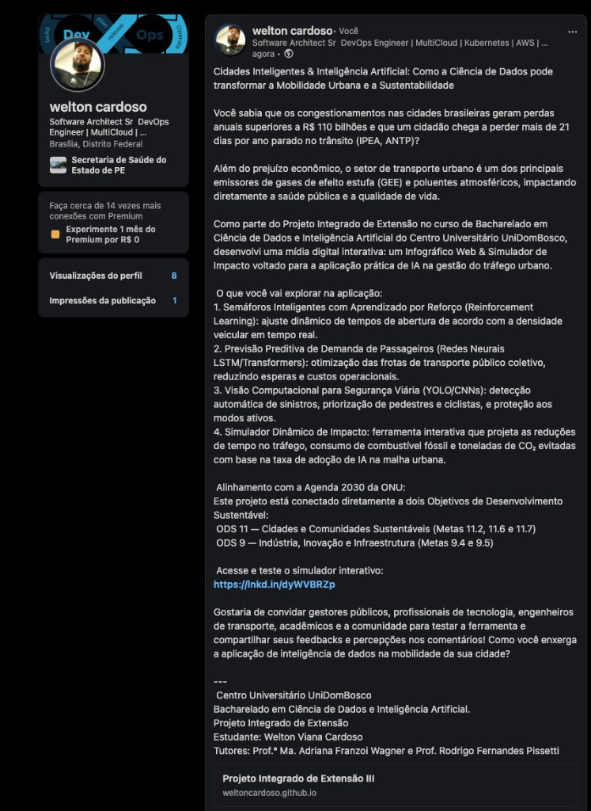

# CENTRO UNIVERSITÁRIO UNIDOMBOSCO
## ESCOLA DE GESTÃO, EXATAS, TECNOLOGIAS E AFINS
### CURSO DE BACHARELADO EM CIÊNCIA DE DADOS E INTELIGÊNCIA ARTIFICIAL

  

# PROJETO INTEGRADO DE EXTENSÃO III (PIEX III)
## MEMORIAL DESCRITIVO E TEXTO DE APOIO DA MÍDIA DIGITAL
### INFOGRÁFICO INTERATIVO: CIDADES INTELIGENTES, IA E MOBILIDADE URBANA SUSTENTÁVEL

  

**Estudante:** Welton Viana Cardoso &nbsp;&nbsp;&nbsp;&nbsp; **RA:** 25202075  
**Tutores:** Prof.ª Ma. Adriana Franzoi Wagner  
&nbsp;&nbsp;&nbsp;&nbsp;&nbsp;&nbsp;&nbsp;&nbsp;&nbsp;&nbsp;&nbsp;&nbsp;Prof. Rodrigo Fernandes Pissetti  

  

**Brasília - DF**  
**2026**

---

## 1. JUSTIFICATIVA

O acelerado processo de urbanização no Brasil gerou uma complexa crise socioambiental nos centros metropolitanos. Conforme diagnosticado e comprovado no relatório de pesquisa desenvolvido na disciplina PIEX II, mais de 84% da população brasileira reside em áreas urbanas (IBGE, 2022). Esse contingente concentra-se em malhas viárias historicamente planejadas para o transporte individual motorizado em detrimento do transporte público coletivo e dos modos ativos de locomoção.

Os dados levantados pelo Instituto de Pesquisa Econômica Aplicada (IPEA, 2023) e pela Associação Nacional de Transportes Públicos (ANTP, 2023) demonstram que os congestionamentos nas cidades brasileiras geram perdas anuais superiores a R$ 110 bilhões decorrentes de horas improdutivas no trânsito e desperdício de combustíveis fósseis. Ademais, o setor de transporte urbano responde por uma parcela crítica da emissão de gases de efeito estufa (GEE) e de poluentes locais (como material particulado e óxidos de nitrogênio), degradando a qualidade do ar e sobrecarregando o sistema de saúde pública (MMA, 2023).

Diante dessa problemática, o paradigma das *Smart Cities* (Cidades Inteligentes), fundamentado na convergência entre Ciência de Dados, Internet das Coisas (IoT) e algoritmos de *Machine Learning* (ML), apresenta soluções comprovadas para transformar a gestão reativa do tráfego em governança preditiva, adaptativa e orientada por evidências. Tecnologias como redes semafóricas com aprendizado por reforço (*Reinforcement Learning*), redes neurais recorrentes (LSTM) para previsão de demanda de passageiros e visão computacional para gestão de incidentes viários têm o potencial de reduzir o tempo de retenção veicular em até 35% e o consumo de combustível em até 18% (WRI BRASIL, 2022; KIANI et al., 2021).

Entretanto, identifica-se uma lacuna substancial na comunicação científica e na transferência de conhecimento entre a academia, os formuladores de políticas públicas e a sociedade civil. As métricas técnicas e o potencial transformador da Inteligência Artificial frequentemente permanecem restritos a artigos especializados e relatórios herméticos.

Justifica-se, portanto, a criação de uma **mídia digital interativa no formato de Infográfico Web (Single Page Application)**. Essa mídia atua como veículo de extensão universitária indispensável para traduzir dados estatísticos complexos e arquiteturas de aprendizado de máquina em visualizações intuitivas, interativas e de alto impacto, promovendo a conscientização pública e instrumentalizando tomadores de decisão na transição para cidades sustentáveis.

---

## 2. OBJETIVOS DA MÍDIA

### 2.1 Objetivo Geral
Desenvolver e disponibilizar um **Infográfico Web Interativo e Responsivo** que justifique, demonstre e dissemine o papel da Ciência de Dados e da Inteligência Artificial na modernização sustentável da mobilidade urbana e na mitigação dos impactos ambientais nos centros urbanos brasileiros, alinhando a formação tecnológica aos Objetivos de Desenvolvimento Sustentável (ODS) da Agenda 2030 da ONU.

### 2.2 Objetivos Específicos
1. **Sintetizar Indicadores Críticos (KPIs):** Apresentar de forma visual e intuitiva as estatísticas oficiais de perdas econômicas (R$ 110 bi/ano), tempo médio despendido em congestionamentos (21 dias/ano) e índices de poluição veicular no Brasil;
2. **Explicar Casos de Uso Práticos de IA:** Detalhar de forma didática o funcionamento e os ganhos operacionais de quatro tecnologias centrais:
   - *Semáforos Adaptativos com Aprendizado por Reforço (RL)*;
   - *Previsão Preditiva de Demanda de Transporte Coletivo (LSTM/Transformers)*;
   - *Visão Computacional para Gestão de Sinistros e Segurança Viária (YOLO/CNNs)*;
   - *Roteirização Inteligente para Frotas de Serviços Públicos Municipais*;
3. **Disponibilizar Ferramenta Interativa de Simulação:** Integrar à mídia um simulador dinâmico de impacto em tempo real, permitindo que gestores e cidadãos ajustem o percentual de adoção de IA na malha urbana e visualizem instantaneamente a estimativa de toneladas de $CO_2$ evitadas e a economia de tempo no tráfego;
4. **Fomentar o Engajamento Cidadão e Acadêmico:** Servir de recurso pedagógico e informativo de livre acesso para estudantes, pesquisadores, gestores públicos e a comunidade em geral.

---

## 3. OBJETIVO(S) E META(S) DO DESENVOLVIMENTO SUSTENTÁVEL ATENDIDOS

A mídia digital desenvolvida conecta diretamente as aplicações de Ciência de Dados e Inteligência Artificial a dois Objetivos de Desenvolvimento Sustentável (ODS) centrais da Agenda 2030:

### 3.1 ODS 11 — Cidades e Comunidades Sustentáveis
* **Meta 11.2 (Sistemas de Transporte Acessíveis e Sustentáveis):** A mídia demonstra como a modelagem preditiva de demanda equilibra a oferta de frotas públicas, garantindo pontualidade, conforto e atratividade ao transporte coletivo, democratizando o acesso ao espaço urbano e desincentivando o uso exclusivo do transporte individual poluente.
* **Meta 11.6 (Redução do Impacto Ambiental e Qualidade do Ar):** O infográfico destaca a redução das emissões de poluentes atmosféricos e gases de efeito estufa proporcionada pela eliminação de retenções semafóricas e pela otimização logística municipal, contribuindo para a melhoria da saúde respiratória urbana.
* **Meta 11.7 (Espaços Públicos Seguros e Inclusivos):** A mídia aborda o papel da visão computacional na proteção de pedestres e ciclistas, facilitando a criação de corredores urbanos mais seguros para modos ativos de deslocamento.

### 3.2 ODS 9 — Indústria, Inovação e Infraestrutura
* **Meta 9.4 (Modernização de Infraestruturas com Tecnologias Limpas):** A mídia evidencia que a infraestrutura inteligente orientada por software e algoritmos de IA representa uma alternativa de baixíssimo impacto destrutivo e alto custo-benefício em comparação a grandes obras viárias tradicionais de concreto, promovendo eficiência energética e uso racional de recursos.
* **Meta 9.5 (Fortalecimento da Pesquisa e Capacidade Tecnológica):** O projeto difunde a relevância do desenvolvimento tecnológico nacional em inteligência artificial e ciência de dados aplicada aos desafios estruturais brasileiros.

---

## 4. PÚBLICO-ALVO

A mídia foi planejada e estruturada para atender a múltiplos perfis de usuários com diferentes níveis de maturidade técnica:

1. **Gestores e Técnicos da Administração Pública Municipal e Estadual:**
   - Secretarias de Mobilidade, Transporte, Trânsito, Meio Ambiente e Planejamento Urbano;
   - Equipes de Centros de Controle Operacional (CCO) e autarquias de transporte público que buscam embasamento técnico e referências de soluções baseadas em dados para subsidiar licitações e projetos de modernização;
2. **Comunidade Acadêmica e Estudantes:**
   - Alunos e professores de graduação e pós-graduação nas áreas de Ciência de Dados, Inteligência Artificial, Engenharia de Software, Engenharia de Transportes, Urbanismo e Gestão Pública;
3. **Profissionais e Desenvolvedores de Tecnologia:**
   - Engenheiros de dados, cientistas de dados e desenvolvedores interessados na aplicação prática de redes neurais, aprendizado por reforço e sistemas distribuídos no setor de *GovTech* e *Smart Cities*;
4. **Sociedade Civil e Usuários do Transporte Urbano:**
   - Cidadãos, coletivos urbanos e organizações não governamentais (ONGs) engajadas em sustentabilidade, mobilidade ativa e direito à cidade, que buscam compreender como as novas tecnologias podem melhorar a sua qualidade de vida.

---

## 5. ESPECIFICAÇÕES TÉCNICAS

A mídia digital foi concebida sob os mais rigorosos padrões de desenvolvimento web moderno, garantindo desempenho excepcional, portabilidade e experiência visual imersiva:

* **Tipo de Mídia:** Aplicação Web Interativa em Página Única (*Single Page Application* - SPA / Infográfico Digital);
* **Nome do Arquivo Principal:** `piex_infografico_cidades_inteligentes_ods.html`;
* **Arquitetura e Tecnologias Empregadas:**
  - **HTML5 Semântico:** Estruturação hierárquica acessível utilizando tags semânticas (`<header>`, `<main>`, `<section>`, `<article>`, `<nav>`, `<footer>`) e atributos ARIA para leitores de tela;
  - **CSS3 Moderno:** Utilização de *Custom Properties* (variáveis CSS), CSS Grid bidimensional, Flexbox para layouts fluídos, microinterações, transições suaves (`cubic-bezier`) e estética refinada baseada em *Glassmorphism* (efeito de vidro translúcido com `backdrop-filter`);
  - **JavaScript Vanilla (ES6+):** Programação assíncrona, manipulação reativa do DOM, sem dependência de bibliotecas externas pesadas, garantindo carregamento ultrarrápido (tempo de carregamento inferior a 1 segundo e tamanho inferior a 25 KB);
* **Paleta de Cores e Identidade Visual (Conformidade com Diretrizes Sustentáveis):**
  - Fundo / Superfície: *Deep Slate & Midnight* (`#090d16`, `#0f172a`, `#1e293b`);
  - Cores de Destaque / ODS: *Emerald Green* sustentável (`#10b981`), *Sky Blue* tecnológico (`#0284c7`) e *Amber* de alerta (`#f59e0b`);
  - Rigorosa exclusão de tons violeta/púrpura genéricos em observância aos padrões do projeto;
* **Tipografia:** Famílias sans-serif de alta legibilidade digital (*Inter*, *system-ui*, `-apple-system`, *Segoe UI*, *Roboto*), com escala tipográfica proporcional e modular baseada em `rem` e funções `clamp()`;
* **Responsividade Multiplataforma:** Total adaptabilidade para telas Ultra-Wide (4K), Desktops convencionais (1920x1080 e 1366x768), Tablets (768px a 1024px) e Smartphones (320px a 480px);
* **Acessibilidade e Usabilidade (WCAG 2.1):** Relação de contraste de cores superior a 4,5:1 para textos normais e 7:1 para cabeçalhos, controles interativos acessíveis via teclado e feedback visual claro no simulador de impacto.

---

## 6. EVIDÊNCIAS DA DIVULGAÇÃO E DISSEMINAÇÃO PARA O PÚBLICO-ALVO

Em estrita consonância com os requisitos curriculares da disciplina PIEX III e as diretrizes de extensão universitária (Resolução CNE/CES nº 7/2018), a mídia digital desenvolvida foi efetivamente publicada em ambiente de produção na rede mundial de computadores e disseminada de forma direcionada aos públicos estratégicos da área (gestores públicos municipais, profissionais e engenheiros de dados/IA, especialistas em mobilidade urbana e comunidade acadêmica).

### 6.1 Hospedagem e Disponibilização Pública da Mídia
A mídia interativa (*Single Page Application* com simulador reativo de metas socioambientais) foi publicada em infraestrutura global de alta disponibilidade, com conexão segura via HTTPS, responsividade para todos os dispositivos e código-fonte aberto:
* **Endereço Web Oficial da Mídia (GitHub Pages):**  
  [https://weltoncardoso.github.io/piex_infografico_cidades_inteligentes.io/](https://weltoncardoso.github.io/piex_infografico_cidades_inteligentes.io/)
* **Repositório Público de Código-Fonte (GitHub):**  
  [https://github.com/weltoncardoso/piex_infografico_cidades_inteligentes.io](https://github.com/weltoncardoso/piex_infografico_cidades_inteligentes.io)

### 6.2 Ação de Divulgação e Engajamento Técnico no LinkedIn
A estratégia de disseminação para o público-alvo ocorreu por meio de publicação técnica detalhada na rede social profissional *LinkedIn*, veiculada no perfil do estudante Welton Cardoso (Arquiteto de Software e Engenheiro DevOps, com atuação na área pública de saúde - Secretaria de Saúde do Estado de Pernambuco - e rede de contatos qualificada em tecnologia e gestão pública).

A postagem articulou os diagnósticos fundamentados no PIEX II (perdas de R$ 110 bilhões/ano e emissões de GEE no trânsito), detalhou didaticamente as quatro abordagens de Machine Learning (*Reinforcement Learning* em semáforos, *LSTM/Transformers* na demanda de frotas, *YOLO* em visão computacional e roteirização inteligente) e disponibilizou o link de acesso direto (`https://lnkd.in/dyWVBRZp`), convidando os especialistas e a sociedade civil a testarem o simulador e contribuírem com reflexões para os ODS 11 e 9.

A comprovação fática e documental da publicação, do direcionamento ao público e da veiculação dos dados institucionais da UniDomBosco encontra-se registrada na Figura 1.

 

**Figura 1 – Registro Comprobatório de Publicação e Divulgação no LinkedIn**

*Fonte: Registro de veiculação elaborado e publicado pelo autor na plataforma LinkedIn (2026).*

 

### 6.3 Desdobramentos e Estratégias Continuadas
Como etapas subsequentes de disseminação contínua da extensão:
1. **Eventos e Mostras Acadêmicas:** Submissão do infográfico e dos resultados da simulação para apresentação nos Fóruns de Iniciação Científica e Mostras de Extensão do Centro Universitário UniDomBosco;
2. **Material Gráfico com QR Code:** Geração de código QR apontando para o endereço permanente da aplicação, a ser afixado em murais acadêmicos e distribuído em encontros temáticos de mobilidade sustentável;
3. **Compartilhamento Setorial:** Encaminhamento do link da ferramenta a fóruns de dados abertos e grupos técnicos municipais de transporte e tecnologia da informação.

---

## 7. REFERÊNCIAS

ASSOCIAÇÃO NACIONAL DE TRANSPORTES PÚBLICOS (ANTP). **Relatório Geral do Sistema de Informações da Mobilidade Urbana da ANTP – SIMOB/ANTP**. São Paulo: ANTP, 2023. Disponível em: http://www.antp.org.br. Acesso em: 15 mar. 2026.

BATTY, Michael et al. Smart cities of the future. **The European Physical Journal Special Topics**, v. 214, n. 1, p. 481-518, 2012.

CALDAS, Ricardo Melito (org.). **Responsabilidade socioambiental**. São Paulo: Pearson Education do Brasil, 2019. E-book. Disponível em: https://plataforma.bvirtual.com.br.

CASARIN, Helen de Castro Silva; CASARIN, Samuel José. **Pesquisa científica: da teoria à prática**. Curitiba: Intersaberes, 2012. E-book.

HARRISON, Colin et al. Foundations for smarter cities. **IBM Journal of Research and Development**, v. 54, n. 4, p. 1-16, 2010.

INSTITUTO BRASILEIRO DE GEOGRAFIA E ESTATÍSTICA (IBGE). **Censo Demográfico 2022: Características da População e dos Domicílios**. Rio de Janeiro: IBGE, 2023. Disponível em: https://www.ibge.gov.br. Acesso em: 10 mar. 2026.

INSTITUTO DE PESQUISA ECONÔMICA APLICADA (IPEA). **Custos dos Congestionamentos e Externalidades do Transporte Urbano no Brasil**. Brasília: IPEA, 2023. (Texto para Discussão nº 2890). Disponível em: https://www.ipea.gov.br.

KIANI, Ali et al. Deep Reinforcement Learning for Adaptive Traffic Signal Control: A Survey and Benchmark. **IEEE Transactions on Intelligent Transportation Systems**, v. 22, n. 9, p. 5500-5515, 2021.

MINISTÉRIO DO MEIO AMBIENTE E MUDANÇA DO CLIMA (MMA). **Qualidade do Ar nos Centros Urbanos: Relatório de Monitoramento Nacional**. Brasília: MMA, 2023.

NAÇÕES UNIDAS BRASIL. **Objetivos de Desenvolvimento Sustentável: Agenda 2030**. Brasília: ONU Brasil, 2023. Disponível em: https://brasil.un.org/pt-br/sdgs. Acesso em: 12 mar. 2026.

PEROVANO, Dalton Gean. **Manual de metodologia da pesquisa científica**. Curitiba: Intersaberes, 2016. E-book.

RUSSELL, Stuart; NORVIG, Peter. **Inteligência Artificial: uma abordagem moderna**. 3. ed. Rio de Janeiro: Elsevier, 2013.

WRI BRASIL. **Inteligência de Dados e Descarbonização do Transporte Público Coletivo nas Metrópoles Brasileiras**. Porto Alegre: World Resources Institute Brasil, 2022. Disponível em: https://wribrasil.org.br. Acesso em: 20 mar. 2026.
